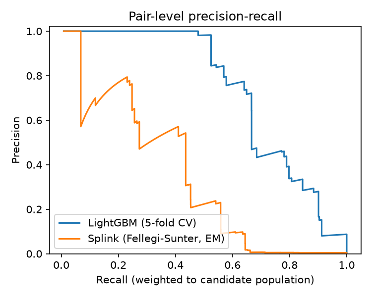
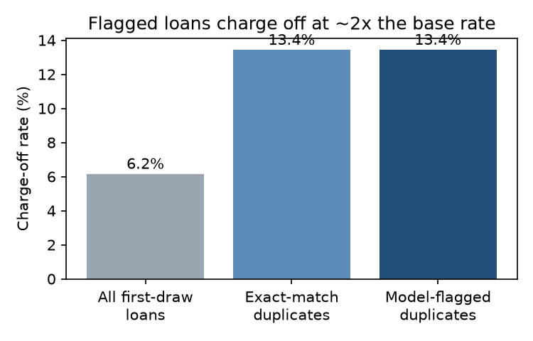
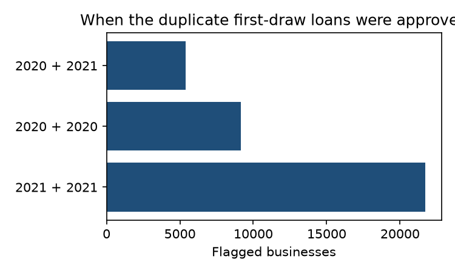

# PPP Duplicate Loan Detection

Entity resolution on the public **Paycheck Protection Program (PPP)** loan file. The goal is to find businesses that appear to hold **more than one first-draw PPP loan**. Program rules allowed one first-draw loan per business, and lenders could only see their own loans.

The public data has no shared business ID (no EIN), so the same borrower shows up under spelling variants, DBA names, different addresses, and different lenders. This project links those records into businesses, which no single lender could do on its own.

> "Duplicate" here means *the public fields indicate the same borrower holds 2+ first-draw loans*. It is **not** a finding of fraud. Some duplicates have legitimate explanations, such as a loan cancelled and re-booked elsewhere, or affiliated entities.

## Results (full national file, 8.6M first-draw loans)

| | Value |
|---|---|
| Possible loan pairs | 3.7 × 10¹³ |
| Candidate pairs after multi-pass blocking | **12.4M** |
| Labeled pairs (stratified, 3 draws) | 2,357 (104 matches) + 72 undetermined, excluded |
| **LightGBM matcher**, weighted F1 (5-fold grouped CV) | **0.70** (95% CI 0.57–0.84) |
| Splink (Fellegi–Sunter, EM-trained) on the same pairs | 0.47 (95% CI 0.37–0.58) |
| Businesses flagged with 2+ first-draw loans | **36,288** (73,657 loans) |
| Loan dollars beyond each business's first loan | **$1.05B** across 37,369 extra loans |
| Flagged businesses that borrowed from 2+ different lenders | 68% |
| Exact name + address + ZIP matching (baseline) | 22,574 businesses, $710M → the model finds **1.6×** as many |
| Manual review of 150 random flagged businesses | 145 same borrower, 5 undetermined, 0 clearly wrong |
| Charge-off rate of flagged loans vs all first-draw loans | **13.4% vs 6.2%** |

The charge-off rate is an outcome the model never saw. Flagged loans charge off at about 2.2× the base rate, the same rate as exact-match duplicates. So the additional 13.7K businesses the model finds carry the same risk profile as the obvious cases.





About 60% of flagged businesses took both loans in 2021, and 85% of those are sole proprietors or self-employed borrowers. That matches the 2021 wave of small individual PPP loans issued through online lenders.

## Why Splink loses here

Splink's Fellegi–Sunter model treats agreement on each field as independent evidence. In PPP data, that independence breaks down:

- **Large office buildings and apartment complexes.** Thousands of unrelated borrowers share an address, so address agreement says little.
- **Franchises and chains.** Agreement on a name like "SUBWAY" or "STATE FARM INSURANCE" says little.
- **Generic placeholder names.** Strings like "SELF EMPLOYED" and "INDEPENDENT CONTRACTOR" show up as borrower names.

At its default 0.5 threshold, Splink's precision on the candidate population is about 0.5%. LightGBM learns interactions such as *same name, but the name is common and the address is a big building*, using name-frequency and address-frequency features.

## Pipeline

```
src/01_load.py               download 13 SBA FOIA CSVs (5.2 GB) → DuckDB
src/02_standardize.py        legal-suffix stripping, DBA splitting, USPS-style address normalization
src/03_blocking.py           5 blocking rules (ZIP+name prefix, ZIP+street address, state+name,
                             state+sorted name tokens, legal name = DBA name), blocks capped at 50
src/04_features.py           26 pairwise features: Jaro-Winkler / Levenshtein / token overlap
                             (legal and DBA names), address similarity, NAICS, business type,
                             lender, amount and jobs ratios, name/address frequency
src/05*_sample_*.py          3 stratified labeling draws (score-uniform, name-similar, likely-match)
src/06_splink_baseline.py    Splink 5 on identical blocking keys; u by random sampling, m by EM
src/07_train_matcher.py      LightGBM, 5-fold CV grouped by connected components; population-weighted
                             metrics + bootstrap CIs; scores all 12.4M candidate pairs
src/08_cluster_flag.py       threshold 0.8 → graph connected components → flagged businesses;
                             drops pairs where the earlier loan closed before the later one was approved
src/09_report.py             figures
```

Run end to end (about 20 minutes on a laptop, plus labeling):

```bash
python -m venv .venv && source .venv/bin/activate
pip install -r requirements.txt
make all   # data goes to ../ppp-data (override with PPP_DATA=/path)
```

## Evaluation design and limitations

- **No ground truth.** PPP data has no business ID, so labels were built by reviewing record pairs on the public fields.
  - Labeling was a single LLM-assisted review pass with no second annotator. Pairs that could not be decided from the fields (for example, two people with the same common name in the same metro area, or parent and child at the same farm address) were marked undetermined and excluded.
  - Labels are in `labels/labels.csv` as loan-number pairs only.
- **Weighting.** The three draws are stratified samples. Every metric is re-weighted by `N_stratum / n_labeled_stratum`, so it estimates performance on all 12.4M candidates, not on the oversampled label set.
- **Small positive count.** 104 matched pairs give wide confidence intervals. The bootstrap CIs above are the honest range.
- **Blocking recall is not measured.** It can't be measured without ground truth, so true duplicates that share no blocking key (for example a new name *and* a new address) are missed. The flagged count is therefore a lower bound.
- **Same borrower ≠ violation.** Affiliated LLCs are separate borrowers. Labels treat two different legal entities as different, even when the owner and address are the same.

## Data

U.S. Small Business Administration, *PPP FOIA* loan-level data (as of 2024-09-30), public domain: https://data.sba.gov/dataset/ppp-foia. Raw data is not committed. Run `src/01_load.py` to download it.

## License

MIT
